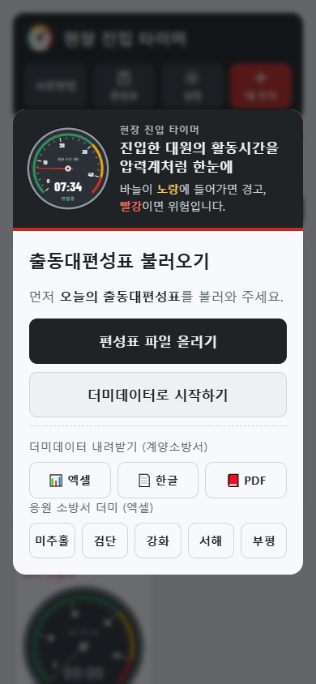
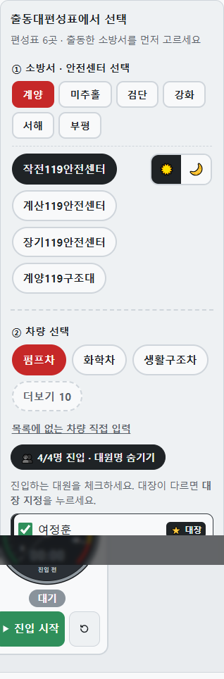
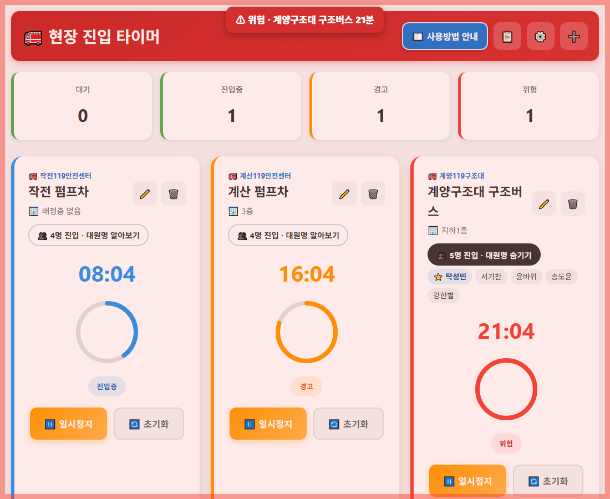
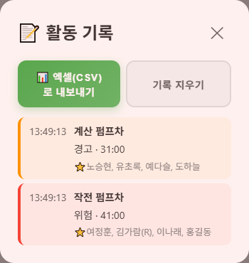

# 🚒 현장 진입 타이머 (소방청)

화재 현장 **지휘부**가 출동대편성표를 불러와 **어느 차량의 누가, 언제 진입해서, 얼마나 지났는지** 한눈에 보고,
공기호흡기 사용 한계(20~30분)에 가까워지면 소음 속에서도 놓치지 않도록 **소리·진동·음성·화면 깜빡임**으로 알려 주는 웹앱입니다.

## 왜 만들었나

- 화재진압 시 공기호흡기 사용 가능 시간은 약 20~30분입니다.
- 재난 현장은 소음이 커서 알림음·경고등을 알아채기 어렵습니다.
- 지휘관은 여러 차량·대원이 각각 **얼마나 활동했는지** 파악하기 어렵습니다.
- 이 앱은 대원이 아니라 **지휘부가 조작**합니다. 대원이 진입하면 지휘부가 진입 시작을 누르고, 앱이 시간과 경고를 대신 챙깁니다.

## 화면

| 처음 접속: 편성표 불러오기 | 센터 → 차량 → 진입 대원 |
|---|---|
|  |  |

| 진입 중 (진입중 · 경고 · 위험) | 활동 기록 |
|---|---|
|  |  |

## 주요 기능

| 기능 | 내용 |
|---|---|
| 출동대편성표 불러오기 | 엑셀(xlsx)·한글(hwpx)·PDF 편성표에서 안전센터 → 차량 → 당번팀 운전요원·진압대원을 자동으로 읽음. 처음 접속 시 필수 |
| 응원 출동 (여러 소방서) | 편성표를 소방서별로 여러 개 담음(같은 소방서는 새 파일로 교체, ✕로 빼기). 대 추가에서 ① 소방서 → 안전센터 → ② 차량 순으로 고름. 처음 올린 편성표가 '내 소방서'로 기본 선택 |
| 진입 차량 먼저 | 펌프·탱크·구조·화학차는 바로 보이고 고가·굴절·산불진화·구급차 등은 '더보기' 안에 |
| 직접 입력 | 편성표에 없는 차량은 '목록에 없는 차량 직접 입력'으로 소속·차량 이름을 적어 등록(대원 체크 없음) |
| 더미데이터 | 가짜 이름 편성표 6곳(계양·미추홀·검단·강화·서해·부평)으로 바로 체험. 계양은 엑셀·한글·PDF, 나머지는 엑셀 내려받기 |
| 날짜 확인 | 편성표 날짜가 오늘이 아니면 두 번 확인한 뒤에만 사용 |
| 압력계 타이머 | 공기호흡기 압력계 모양. 바늘이 진입 후 지난 분을 가리키며 초록(진입중) → 노랑(경고) → 빨강(위험) 구간을 지남. 가운데 창에 경과 시간, 아래에 진입 시각. 눈금은 설정한 경고·위험 시간에 맞춰 바뀜 |
| 착순·센터 색 | 센터마다 처음 진입을 시작한 순서로 `1착 작전`, `2착 계산` 배지. 같은 센터 차량은 같은 색 배지·압력계 링으로 묶여 보임. 빨강·주황·노랑·초록은 상태색이라 센터 색으로 쓰지 않음. 초기화해도 착순은 유지 |
| 남은 시간 | 상태 옆에 "경고까지 22분", "위험까지 9분", 위험이면 "위험 1분 넘음" |
| 눈에 띄는 효과 | 위험 카드는 1초마다 빨강 ↔ 흰색, 위험 중 바늘이 살짝 떨림, 경고·위험이 되는 순간 압력계 링이 3번 번쩍임, 센터가 처음 진입하면 착순 배지가 튀어나옴. 기기에서 '동작 줄이기'를 켜면 움직임 없이 색만 바뀜 |
| 상태별 보기 | 위쪽 상황판의 대기·진입중·일시정지·경고·위험을 누르면 그 상태인 대만 보임. 다시 누르거나 '전체 보기'로 해제. 숨겨 둔 대가 경고·위험이 되면 자동으로 전체 보기로 돌아감 |
| 위치 이동 | 진입한 대의 층·구역을 연필 버튼으로 바꾸면 '옮겨 간 것'으로 기록(예: 위치 이동 3층 → 4층). 한 대는 한 곳에만 있고, 공기호흡기를 계속 쓰므로 시간은 끊기지 않고 이어짐 |
| 현황 보고 | '현황 보고'를 누르면 높은 층부터 층별로 어느 대가 몇 분째 진입해 있는지, 대장·인원·이전 위치를 보여 주고 그대로 읽을 보고 문장을 만들어 줌(복사·소리로 읽기) |
| 진입 전 확인 | 대 추가·편집 때 배정 위치(층 또는 구역)를 넣지 않으면 저장되지 않음. 진입 시작 때도 소속·차량, 배정 위치(층 또는 구역), 진입 대원(편성표에 탑승 대원이 있을 때) 중 하나라도 없으면 진입 시작이 안 되고 빠진 항목을 알려 줌. 카드에도 '위치 미입력' 표시 |
| 새로고침 = 새 현장 | 새로고침하거나 앱을 다시 열면 대 목록·활동 기록·착순을 비움(편성표·설정은 유지). 진입 중인 대가 남아 있으면 실수일 수 있으므로 '이어서 하기 / 새 현장 시작'을 물어봄 |
| 입력 확인 | 경고 시간은 위험보다 짧아야 저장. 배정층은 지하10층~200층. 진입 중인 대를 삭제하면 한 번 더 경고하고 기록을 남김 |
| 압력계 톤 | 설정에서 5가지 중 선택: 그래파이트(기본)·블랙·네이비·아이보리·화이트(햇빛 아래) |
| 위험한 대가 맨 위로 | 카드를 위험 → 경고 → 진입중 → 일시정지 → 대기 순으로 자동 정렬. 위험이면 카드 전체가 빨강, 경고면 노랑 바탕 |
| 차량별 타이머 | ① 안전센터 → ② 차량을 골라야 저장. 진입 대원 체크, 주간/야간 선택 |
| 대장 표시 | 진압대원 칸 맨 앞 사람을 대장(⭐)으로, '대장 지정'으로 변경 가능. 카드에 대장 이름이 늘 보임(무전 호출용) |
| 대원명 숨김 | 화면을 단순하게: '대원명 알아보기'를 눌러야 이름 표시 |
| 경고·위험 알림 | 경고(기본 30분)·위험(기본 40분)에 소리·진동·**음성 안내**("위험. 작전 펌프차, 40분 경과"), **화면 깜빡임**(경고 주황 1회, 위험 빨강 계속 + 상단 배너). 위험은 1분마다 음성 반복 |
| 화면 꺼짐 방지 | 진입 중인 차량이 있으면 화면이 꺼지지 않게 유지 (꺼지면 알람이 늦을 수 있음) |
| 활동 기록 | 진입 시작·일시정지·이어서 시작·경고·위험·초기화를 시각·경과·대원과 함께 기록, 엑셀(CSV)로 내보내기 |
| 오프라인 | 한 번 열면 인터넷이 끊겨도 동작 (서비스워커). 편성표 읽기 라이브러리도 앱에 포함 |

## 실행 (Docker)

```bash
docker compose up -d --build
```

브라우저에서 **http://localhost:8080** 접속 → **더미데이터로 시작하기**.

중지: `docker compose down`

> 화면 꺼짐 방지·알림 등 일부 기능은 브라우저 보안상 `localhost` 또는 `https://` 주소에서만 동작합니다.

## 다른 PC에서 이어서 작업하기

필요한 것: [Git](https://git-scm.com), [Node.js](https://nodejs.org) 20 이상, [Docker Desktop](https://www.docker.com/products/docker-desktop), 크롬(테스트용)

```bash
git clone https://github.com/seoulfire0119/field-safety-timer-nfa.git
cd field-safety-timer-nfa
npm install                  # 테스트·화면 캡처 도구
docker compose up -d --build # http://localhost:8080
npm test && npm run test:e2e # 편성표 읽기 + 화면 흐름 테스트
```

고친 뒤 올리기: `git add -A && git commit -m "무엇을 바꿨는지" && git push`
다른 PC에서 받기: `git pull`

배포 (https://field-safty-timer.web.app):

```bash
npm install -g firebase-tools
firebase login               # 프로젝트 권한이 있는 구글 계정
firebase deploy --only hosting
```

배포한 뒤 휴대폰에 예전 화면이 남아 있으면 `public/sw.js` 의 `CACHE_NAME` 버전을 올려서 다시 배포합니다.

## 사용 방법

1. 처음 접속하면 **출동대편성표 불러오기** 창이 뜹니다. 편성표 파일을 올리거나 더미데이터로 시작합니다.
2. 위쪽 **대 추가** 또는 카드의 **연필** 버튼 → **① 안전센터 → ② 차량**을 누릅니다. 대명이 "작전 펌프차"처럼 채워집니다.
3. 필요하면 ☀️주간/🌙야간을 바꾸고, **대원명 알아보기**에서 진입 대원 체크·대장 지정을 합니다.
4. 대원이 진입하면 **▶ 진입 시작**. 경고·위험이 되면 앱이 알립니다.
5. **설정**에서 경고·위험 시간, 소리·진동·음성·화면 깜빡임을 켜고 끄며, **활동 기록**을 보고 내보냅니다.

### 편성표 읽기 규칙

- 표에서 `차량` 칸을 찾고, `(당번)` 팀의 운전요원·진압대원 열을 읽습니다 (비번 팀은 읽지 않음).
- `주)…` `야)…` 로 나뉜 칸은 주간/야간 대원으로 나눕니다. `(고새봄)`처럼 괄호로 쓴 겸직 대원도 포함합니다.
- 안전센터 칸의 `[작전]` → `작전119안전센터`, `계양119구조대`처럼 쓴 칸은 그대로 출동대 이름이 됩니다.
- hwp(옛 한글 형식)는 읽을 수 없으니 한글에서 hwpx로 저장해서 올립니다. 스캔·사진 PDF는 읽을 수 없습니다.
- 주간/야간 기본값은 시계 기준(09~18시 주간)이며, 편집 창에서 직접 바꾸면 그 선택을 12시간 동안 기본값으로 씁니다.

## 데이터와 개인정보

- 서버로 아무것도 보내지 않습니다. 편성표·타이머·활동 기록은 **그 기기 브라우저(localStorage)에만** 저장됩니다.
- ⚙️ → **모든 데이터 초기화**로 편성표(대원 이름)·기록을 모두 지울 수 있습니다.
- 저장소의 샘플 편성표는 모두 **가짜 이름**입니다.

## 테스트

```bash
npm install
npm test              # 편성표 읽기: 더미 엑셀·한글·PDF 가 같은 결과인지 (8개)
npm run test:e2e      # 화면 흐름: 앱 실행 중일 때 크롬으로 확인 (5개)
npm run screenshots   # README 화면 캡처 다시 만들기
```

`test:e2e`·`screenshots`는 실행 중인 앱(`http://localhost:8080`)과 크롬이 필요합니다. 경로가 다르면 `APP_URL`, `CHROME_PATH` 환경 변수로 지정합니다.

## 구성

```
public/              앱 (nginx 가 그대로 서비스하는 정적 파일)
  index.html, app.js 화면·타이머·알림·기록
  roster.js          편성표 읽기 (xlsx·hwpx·PDF → 칸 격자 → 센터·차량·대원)
  storage.js         기기 저장(localStorage)
  sw.js              오프라인 (화면 파일은 네트워크 우선, 나머지는 캐시 우선)
  lib/               SheetJS, JSZip, pdf.js (인터넷 없이 동작하도록 포함)
  samples/           더미데이터 편성표 (계양: 엑셀·한글·PDF, 응원 소방서 5곳: 엑셀)
samples/build_samples.py  더미데이터 만들기 (python. 한글·PDF는 한글 프로그램 필요, --no-hwp 면 엑셀만)
tests/               편성표 읽기·화면 흐름 테스트, 화면 캡처
Dockerfile, nginx.conf, docker-compose.yml
```

> 압력계 숫자 글꼴: Barlow Condensed (SIL Open Font License 1.1), `public/fonts/` 에 포함.
